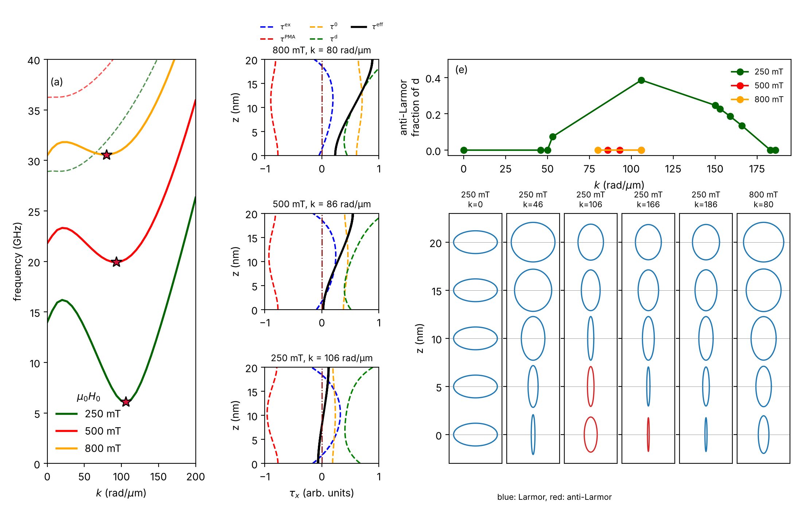
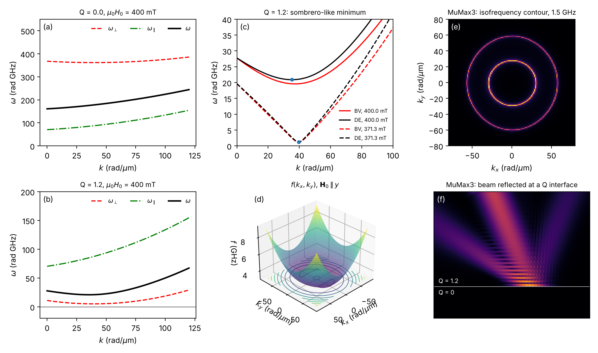
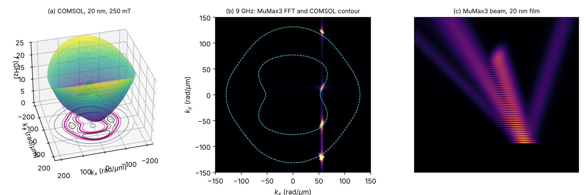

# PMA-in-thin-films

[](https://github.com/Les-nik/PMA-in-thin-films/actions/workflows/tests.yml)

Code and data for

> N. Leśniewski, Y. S. Dadoenkova, F. F. L. Bentivegna, P. Gruszecki,
> "Perpendicular Magnetic Anisotropy in Thin Films Enables Extraordinary Spin-Wave Phenomena:
> Anti-Larmor Precession, Negative Reflection and Refraction, Multireflection and Multirefraction",
> *ACS Applied Materials & Interfaces* **18**(6), 10539-10551 (2026).
> [doi:10.1021/acsami.5c21700](https://doi.org/10.1021/acsami.5c21700)
> ([arXiv:2502.10085](https://arxiv.org/abs/2502.10085))

## The physics in short

Perpendicular magnetic anisotropy (PMA) pulls the magnetization out of the film plane, against
the in-plane bias field. For spin waves this acts as a torque opposite to the exchange,
dipolar and Zeeman torques, and it changes the dispersion in two ways that this repository
reproduces:

* In an **ultrathin film** (2 nm CoFeB) the dispersion gets a minimum at finite k (a
  "sombrero"). An isofrequency contour below the k = 0 frequency then has two branches, so a
  beam hitting an interface splits into two reflected beams, one of them reflected negatively.
* In a **thicker film** (20 nm, Q = 0.6) the PMA torque dominates in part of the thickness for
  some wavevectors, and the magnetization there precesses against the Larmor sense. The
  dispersion takes a "cowboy hat" shape and a single incident beam produces three reflected beams.



*20 nm film: dispersion (a), torque contributions across the thickness (b-d), fraction of the
film that precesses anti-Larmor (e) and precession orbits at five depths (f).*

## Repository layout

| Path | Content |
| --- | --- |
| `pma_spinwaves/ultrathin.py` | analytical dispersion of the ultrathin film (Fig. 1 a-d) |
| `pma_spinwaves/comsol.py` | readers for the COMSOL exports |
| `pma_spinwaves/precession.py` | precession orbits and Larmor / anti-Larmor sense from complex profiles |
| `pma_spinwaves/fourier.py` | isofrequency maps from MuMax3 single-frequency fields |
| `scripts/fig{1,2,3}_*.py` | one script per figure, output in `figures/` |
| `data/comsol/` | COMSOL results: dispersions, thickness profiles, torques, angular sweeps (see `data/README.md`) |
| `simulations/` | MuMax3 scripts and a description of the COMSOL model |
| `tests/` | checks of the model limits, the data readers and the sign conventions |

## Reproducing the figures

```bash
pip install -r requirements.txt
python scripts/download_data.py      # MuMax3 results for Fig. 1(e, f) and 3(b, c), ~53 MB
python scripts/fig1_ultrathin.py
python scripts/fig2_thick_film.py
python scripts/fig3_contours.py
```

Fig. 2 and the analytical panels of Fig. 1 run from the files in the repository alone.





*Fig. 3(b): the bright spots of the MuMax3 Fourier transform lie on the 9 GHz contour computed
independently with COMSOL; all reflected waves share the tangential wavevector of the incident
one.*

## Ultrathin-film model

For a film much thinner than the exchange length, with in-plane field H0 and reduced anisotropy
Q = 2K_u / (mu0 Ms^2):

```
omega^2 = omega_perp * omega_par
omega_perp = gamma mu0 Ms [h + (k l_ex)^2 + (1 - P) - Q]
omega_par  = gamma mu0 Ms [h + (k l_ex)^2 + P sin^2(phi)]
P = 1 - (1 - exp(-k d)) / (k d),   h = H0 / Ms
```

phi is the angle between k and the magnetization. PMA enters only `omega_perp`; when Q is close
to 1 + h that term is small at k = 0 and grows again through exchange, which produces the
minimum at finite k.

## Related

* MuMax3 scripts on Zenodo: [10.5281/zenodo.14871425](https://doi.org/10.5281/zenodo.14871425)
* General postprocessing of MuMax3 dispersions:
  [spin-wave-dispersion](https://github.com/Les-nik/spin-wave-dispersion)

## License

Code: MIT ([LICENSE](LICENSE)). Data in `data/` and the release files: CC BY 4.0.
